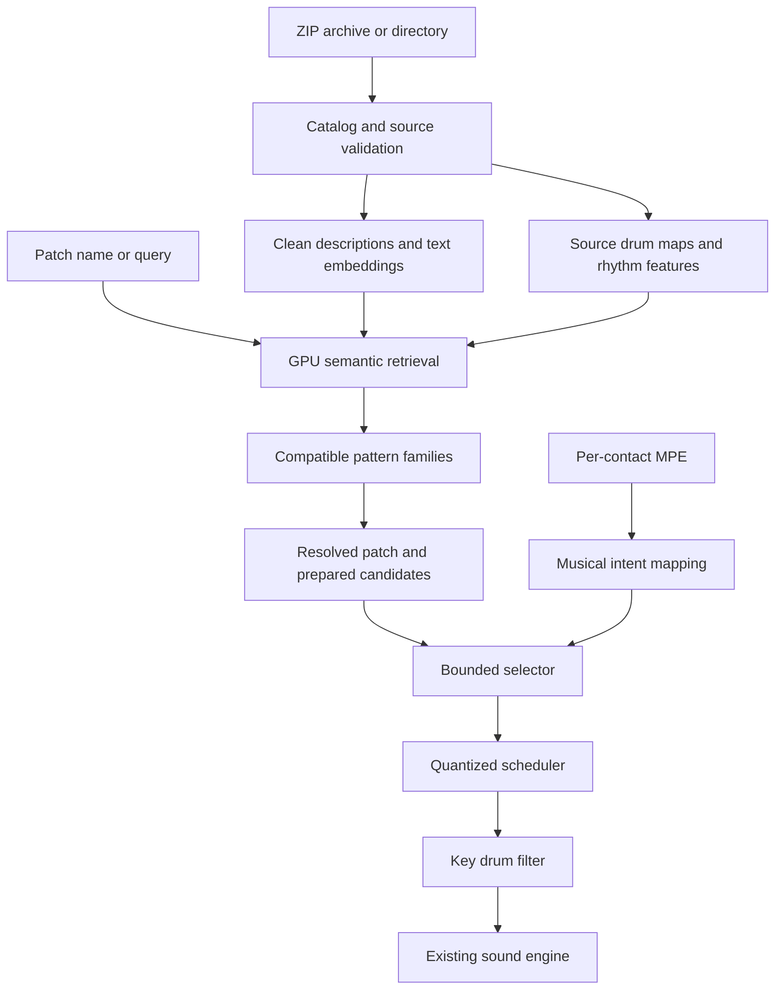

# Neural Pattern Engine Plan

Created: October 17, 2026. Code review updated: October 18, 2026.

Scope: architecture, completed implementation and verification of the neural performance path, grounded in the worktree and the personal Desktop archive. All six phases are implemented. Current results are recorded in the final implementation audit below and in [IMPLEMENTATION.md](IMPLEMENTATION.md); earlier checkpoint notes retain their historical scope. The verified AU and VST3 builds were subsequently installed in the user's plug-in folders for Ableton Live testing, with the previous AU backed up. No release has been published.

Make Roli Drummer resolve a musical patch name into a family of compatible drum patterns, then use each Seaboard contact's gestures to select and shape that key's drum part. Use the personal `800000_Drum_Percussion_MIDI.zip` library as the primary development corpus and acceptance dataset.

The implementation combines pretrained text embeddings, measured rhythm features, deterministic MPE intent matching and the existing native scheduler. Optional seeded generation saves compatible variations alongside their original patterns. Musician feedback, listening sign-off and a physical-controller report are not completion requirements.

## Intended musical behavior

- Selecting or entering `Heavy Rock` searches the indexed library for compatible patterns. A patch stores the query and its resolved performance, rather than depending only on a manually assembled preset.
- Low slide positions favor sparse, relaxed patterns; middle positions favor steady grooves; high positions favor fills. Pressure, glide and strike choose related variations within those regions.
- Each held key gates its own drum part. A hi-hat key adopts only the permitted hi-hat events, even when its source pattern contains a full kit.
- Contacts retain independent expression, selection and voice ownership while sharing musical phase.
- New matching imports expand existing families. Coherent groups poorly covered by existing queries can produce suggested patch names.
- Saved sessions reproduce their resolved patterns after the library grows. Fresh searches can use the newer library revision.

## Personal library findings

Source archive: `/Users/tonygermaneri/Desktop/800000_Drum_Percussion_MIDI.zip`.

The complete directory inventory and SHA-256 scan established these counts:

| Measurement | Result |
| --- | ---: |
| Archive size in bytes | 934,178,776 |
| Total archive entries, including directories and metadata | 1,249,306 |
| MIDI-named entries excluding macOS metadata | 774,268 |
| Excluded Apple metadata entries with MIDI extensions | 419,821 |
| Unique MIDI-named file payloads by SHA-256 | 676,726 |
| Additional exact duplicate copies | 97,542 |
| Entries beginning with the standard MIDI header | 774,256 |
| MIDI-named entries without that header | 12 |
| Files under `Superior Drummer 2 Drum Midi [425,000 files]/00071@FullKit` | 247,299 |

Unique payload counts include unsupported entries. A standard header is an initial format check, not proof that a complete file parses successfully.

The archive also exposes compatibility requirements for ingestion. Its classic ZIP footer advertises only 4,122 entries because the entry count wraps at 16 bits; inventory must count the actual central-directory records. Some entries use trailing ZIP data descriptors with zero sizes in their local headers. Some MIDI payloads contain valid declared tracks followed by vendor data. Use a streaming archive reader with CRC and size checks, validate the declared MIDI envelope, and distinguish recoverable vendor trailers from truncated tracks. A scan that silently stops at the footer's wrapped count is not a successful import.

A sample combining a deterministic random selection with coverage across library subtrees contained 2,381 files. The existing JavaScript reader parsed 2,380; the remaining sample lacked a standard MIDI header. Among parsed samples, 707 lacked tempo events, 32 contained notes on multiple channels, and 93 contained no notes covered by the current factory kit's note filters before remapping. Observed meters included 7/8, 9/8, 15/16 and 19/16. These are sample findings, not whole-library prevalence estimates.

The directory hierarchy supplies important musical context:

```text
GM - Rock 1 / ... / Hard Rock / 180 Hard Rock 04b Fill 2.mid
```

Other entries describe rhythm without naming a genre:

```text
00071@FullKit / 0991@4#4_STRAIGHT_HiHat / EighthNote /
Theme-20 / Variation-0 / Beat-112-0.mid
```

Embed useful context from the full relative path. Generic theme and variation identifiers should not create invented style labels. The `FullKit` subtree accounts for approximately 32% of entries, so retrieval, statistics and future training must control family imbalance.

## Architecture



Text embeddings express semantic similarity between names. Rhythm features express measurable pattern behavior. An explicit gesture mapping connects MPE values to musical intent coordinates such as activity, accent strength, variation and fill role. Numeric gestures and text embeddings do not acquire a shared meaning automatically.

These are finite-dimensional inner-product spaces; no additional Hilbert-space machinery is needed for the initial design. Keep text coordinates separate from rhythm and gesture coordinates, then combine their scores and constraints in the resolver. Kit compatibility uses canonical parts, articulations and available kit metadata. Filenames alone cannot establish sample timbre, so the musician's assigned sounds remain the playback palette.

The Seaboard's 49 physical keys remain assignable. Simultaneous independent contacts follow the configured MPE zone and the scheduler's capacity; conventional lower-zone MPE supplies 15 member channels. Test that capacity separately from the keyboard's key count.

Use separate representations for source aliases, normalized performances and semantic descriptions. Two identical files can have different descriptive paths; two different files can represent the same performance exported for different drum maps. Preserve those relationships without allowing copies to receive extra ranking weight.

## Implementation phases

### Phase 1 Archive ingestion and catalog

Support ZIP and directory sources through a common import interface. Read archive entries directly instead of creating hundreds of thousands of loose files. Store source archive identity, entry location, content hash, validation status and cached pattern data.

Use the existing libarchive integration for streaming ZIP reads; the current JUCE ZIP reader's entry-count behavior is unsuitable for this corpus. Support ZIP64 as well as the wrapped classic footer in this particular archive. Bound decompressed file sizes, note counts and metadata; check CRCs and actual end-of-archive before publishing a completed revision.

Exclude `__MACOSX`, AppleDouble entries and unrelated assets before MIDI processing. Report unsupported files individually while continuing the import. Keep original paths for lookup and provenance, with separate normalized text for search.

Use a dedicated native indexing worker with cancellation, progress, checkpoints and resumable batches. Retain the separate neural work queue so a long import or query cannot delay ordinary patch edits and program requests. Coordinate catalog writes across plugin instances and commit complete index revisions atomically.

Keep parsed data and catalog storage bounded and independent of the Vue document. Page search results and graph children; do not send the full catalog through the WebView bridge or insert it into every saved patch.

Deliverable: the archive can be imported, interrupted, resumed and browsed through its catalog while the instrument remains playable.

### Phase 2 Musical metadata and drum normalization

Build structured descriptions from directory hierarchy, filenames, useful track names and markers. Normalize conventions such as `4#4`, `QTR`, underscores, ordering prefixes and damaged display characters without changing source lookup paths. Decode abbreviations according to their library context; a suffix such as `F4` is not sufficient by itself to prove a fill role.

Preserve meter, tempo events, track/channel selection, loop length, phrase boundaries and original timing resolution. A tempo parsed from a filename is a separate estimate with provenance; missing tempo metadata should not become an invented source tempo. DAW tempo remains authoritative during performance.

Resolve source notes through a library-specific instrument and articulation map:

```text
Source MIDI note
    -> source instrument and articulation
    -> canonical drum role
    -> assigned Seaboard key and sound
```

Provide per-library defaults, narrower overrides and corrections for uncertain articulations. A classifier recognizing a note number does not establish the correct instrument identity. Retain unknown notes and report usable coverage instead of silently assigning unrelated drums.

Freeze the mapping policy with each completed source revision. Historical binding retrieval must use its recorded mapping version rather than reinterpret old notes through the newest inference rules. For ambiguous vendor exports, prefer an unknown articulation until an explicit source map or override establishes the role. Display the effect on usable part coverage and offer an explicit reanalysis action.

Measure both whole-pattern and per-part behavior: onset density, accents, velocity distributions, syncopation, timing deviations, subdivision, activity near phrase endings and part availability. Combine role labels with these measurements to estimate sparse groove, steady groove, fill, intro and ending behavior.

Deduplicate exact bytes first, then identify equivalent performances after validated source-map normalization. Preserve human timing and dynamics when constructing musical fingerprints. Keep near-duplicate variations distinct but related.

Deliverable: patterns have inspectable musical features, source-map provenance and reliable part routing, including percussion outside the current factory palette.

### Phase 3 Semantic retrieval and reproducible patches

Evaluate a pretrained local text embedding model against real library queries. Start with [`all-MiniLM-L6-v2`](https://huggingface.co/sentence-transformers/all-MiniLM-L6-v2), which supplies 384-dimensional embeddings under Apache-2.0. Compare retrieval against a lexical baseline and use the actual library to decide whether another model is necessary.

Run inference natively with the editor closed. Evaluate [ONNX Runtime with Core ML acceleration](https://onnxruntime.ai/docs/execution-providers/CoreML-ExecutionProvider.html) on macOS, with CPU support for compatible fallback and Intel builds. Pin tokenizer, pooling, normalization, model and preprocessing versions. Verify the minimum operating-system version and both architecture slices of the actual runtime package; a CPU fallback does not remove the runtime binary's OS requirements. Bundle model assets and licenses, verify checksums, and sign nested native libraries before signing the outer plug-in or app.

Implement GPU similarity search over normalized embeddings using Metal matrix operations. Maintain a CPU reference, test close-score behavior and use canonical rescoring around ambiguous boundaries. Stable IDs and tie rules must make selection reproducible for a fixed index revision.

Cache embeddings for repeated normalized descriptions. At one 384-dimensional float32 vector per unique file payload, raw vectors alone would occupy approximately 991 MiB, before metadata or additional alias descriptions. Share immutable resources within a process and benchmark float16 or quantized storage against retrieval accuracy. Evaluate hierarchical search over semantic groups before rhythm-based ranking within those groups.

Combine semantic similarity with meter, feel, role, drum coverage and phrase compatibility. Filter each key's actual part, phrase cycle and feel before representative sampling, and use per-part activity to retain sparse and dense endpoints. Whole-kit activity must not hide a rare compatible percussion part. Apply duplicate suppression and family diversity so large export sets cannot overwhelm a result. Rank within compatible musical groups rather than blending unrelated meters into one continuous gesture range.

A patch stores a stable identity, query, library revision, model and feature versions, selection rules, mappings, resolved candidate identities, required note data and any generation seed. Migrate the TypeScript model, native compiler, portable archives and DAW state together. Preserve legacy patches through an explicit migration path.

New imports can join one or more strongly matching families. Use versioned affinity thresholds and ambiguity handling. Suggest a new name only for a coherent, sufficiently supported group poorly represented by existing queries. Preserve manual overrides and stable program assignments as the patch bank grows.

Deliverable: `Heavy Rock` retrieves explainable compatible candidates and can be saved and recalled exactly.

### Phase 4 Automatic slide regions

Use the existing zone system for the first complete playable implementation. Resolve a query, choose related sparse, steady and fill material, and populate ordered regions automatically.

Use per-part measurements when choosing candidates. A dense tom fill may contain almost no hi-hat activity; its whole-kit density must not determine the hat key's behavior. Missing parts need an explicit compatible fallback or intentional silence, rather than accidental routing to another instrument.

Retain shared PPQ phase, existing launch and switch quantization, hysteresis, release policy, sustain and contact ownership. Preserve custom sound expression routes and make automatic pattern assignments inspectable and editable.

Deliverable: holding independent kick, snare and hat keys under `Heavy Rock` produces coherent parts; moving one finger through its slide range changes only that part.

### Phase 5 Multidimensional MPE intent

Extend regions to contain candidate groups rather than one clip per zone. Fourteen related fills should remain available without requiring fourteen slide regions or simply increasing the current eight-zone limit.

| Dimension | Initial musical mapping |
| --- | --- |
| Slide | Select sparse, steady and fill regions in a stable order. |
| Press | Favor stronger accents and greater activity within the selected region. |
| Glide | Navigate related rhythmic variations while preserving left/right direction. |
| Strike | Establish initial intensity and variation preference. |
| Lift | Shape release; optionally choose a release-triggered ending in a later extension. |

Lift arrives at note-off and cannot choose a running pattern before release. Press normally arrives as channel pressure in MPE; retain the scheduler's additional support for poly pressure.

Map available gesture values into interpretable musical intent coordinates. Select candidates by weighted distance with smoothing, hysteresis, minimum dwell or transition penalties, and stable tie rules. Slide's role ordering remains a constraint so pressure cannot unexpectedly bypass it. Keep initial mappings configurable rather than treating them as a trained understanding of the musician.

Bound selection work per contact. The full retrieved library must never become the scheduler's clip bus. Retain the active-timeline implementation and preallocated pending note-off heap; prepare a limited candidate set while preserving event tokens, release tails and shared clip deduplication. Current limits are sixteen candidates per region, eight regions per key and 2,048 prepared clips per runtime. Validate documents against those limits before they reach rendering.

No embedding inference, library I/O, catalog locking, GPU waits or unbounded searches belong in the audio callback. Publish prepared state through the existing runtime handoff and retirement mechanism.

Deliverable: simultaneous gestures select related patterns independently, without loss of timing or unpredictable region changes.

### Phase 6 Eigenanalysis and generated variations

Use PCA or SVD on standardized rhythm features to identify directions of variation within compatible families. Eigenvalues measure explained variation; they do not inherently identify energy, genre or musical quality. Relate useful axes to interpretable features and version the fitted transform so imports cannot reverse gesture behavior.

Begin generation with controlled recombination and interpolation of compatible original patterns. Preserve important accents, phrase structure and timing character; vary ghost notes, density and orchestration within explicit limits. Generate outside audio rendering with a seed and save the actual resulting notes and source provenance.

Implement the first generator as follows:

1. Select parents with the same canonical drum part, meter, feel and compatible integral bar lengths. Fit the saved PCA transform on original, deduplicated parents; project generated candidates into that fixed transform.
2. Use a versioned deterministic generator seeded from the saved patch seed, part and parent identities. Recombine beat or bar fragments at musical boundaries, retaining source microtiming and note durations. Preserve strong downbeat/backbeat anchors and the final accent of a fill when present.
3. Bound ghost-note additions, deletions and density changes. Reject wrong-part events, invalid durations, unsupported phrase lengths and results identical to an existing candidate. Do not silently stretch an incompatible phrase to fit.
4. Share the existing candidate budget between original and generated material. With fourteen distinct compatible fills, retain those originals and add at most two generated fills to that sixteen-candidate group. Generation remains optional and inspectable.
5. Save the complete resulting notes, parent identities, algorithm version, seed and constraints. Recall plays those notes directly; it does not rerun a potentially newer generator.

Fourteen matching fills provide useful examples for controlled variation. Their membership does not automatically create a trained neural network, and text embeddings provide no decoder back into MIDI. If this approach does not produce sufficient musical range, evaluate a shared rhythm-generation model conditioned on family and intent, rather than training a separate model for every patch name.

Split any future training and evaluation data by deduplicated musical family to prevent copied exports or close variants from leaking between them. Balance dominant subtrees during feature fitting and training.

Deliverable: reproducible new variations that remain compatible with their source family and satisfy the same drum gates and timing rules as imported patterns.

## Determinism and library updates

The selection contract is: the same committed query, indexed library revision, family-membership snapshot, model/preprocessing/resolver versions, musical features, gesture rules and seed produce the same resolved result. A name alone cannot guarantee an unchanged result after its searchable library or manual family decisions change.

DAW recall and portable patches restore embedded resolved note data and mappings without requiring a fresh search or access to the original archive. A fresh query uses the selected current index revision. Imports update catalog membership without silently changing a running performance. Any explicit refresh prepares a new complete selection and applies it at a defined musical boundary.

The current refresh handoff uses one resolved-pattern bar (`numerator * 4 / denominator` quarter notes), anchored to shared PPQ. A held or pedal-held contact keeps the current runtime until the nearest sample of that boundary; a block spanning it renders its old and new segments separately. Idle instruments adopt immediately. Ordinary sound edits preserve a queued boundary. Explicit patch loads, undo, MIDI programs and host recall cancel it. The saved document represents the prepared selection, while telemetry reports when it is still waiting to play. Seeks rebase the boundary. Fixed retirement queues defer adoption when their off-thread collector falls behind, then recover at a later boundary without deleting resources on audio.

Separate stable patch identity from editable display names. Do not allow new suggestions or renamed patches to shift existing MIDI Program Change assignments unexpectedly. Protect pending resolutions against newer editor edits and DAW recalls using revision guards and cancellation.

The [patch bank helper](native/drummer/include/drummer/PatchBank.h) now uses a persistent 128-position slot-to-patch-ID map. Migration preserves the previously occupied factory/sorted-key positions once. Renames retain identity and storage key; explicit copies receive a new identity. New saves use free slots, missing IDs remain reserved, and a full bank permits browser-only saves without evicting an assignment. Unassigned program messages keep the current patch playing; the former out-of-range wrapping behavior is removed. The header shows the current `P000`–`P127` slot independently of browser sort order.

Resolver 10 and rhythm-space 2 canonicalize covariance, repeated-eigenvalue subspaces, axis/sign ties and saved derived numbers while preserving source timing and dynamics. Committed catalog features are reused on recall. Heavy Rock, Bossa Nova and Jazz Brushes produce byte-identical documents across arm64 GPU, x86_64 GPU and arm64 CPU with two requested generated variations per region and a fixed seed. This establishes those cases; audio is finite and nonzero rather than universally identical between architectures. The repeatable command is [check-neural-determinism.py](native/tools/check-neural-determinism.py), and the final report is /private/tmp/rolidrummer-neural/resolution-phases/determinism-final/determinism-report.json.

Automatic families now persist a stable ID, canonical query, query/model versions, display name, membership revision and manual decisions. Identity includes meter and feel, so text preprocessing cannot collapse `Heavy Rock 7/8` into `Heavy Rock 4/4`. Display-only names and suggestion dismissals update the registry without invalidating musical membership. New imports score deduplicated material against registered families and reconcile off audio. An ambiguous addition remains inspectable in each competing family and requires inclusion before automatic playback. Similar material expands an existing family without creating another saved patch or changing an already saved performance.

Policy version 6 starts with a 0.5 affinity floor, a 0.12 window below each query's best match, a 0.035 ambiguity margin, at least three distinct performances for a suggestion, minimum centroid cohesion of 0.70, and at least half of a named cohort uncovered. These are versioned heuristics, not calibrated probabilities or established musical-quality guarantees. Broader human labels can inform future tuning; they are not required for implementation completion.

Suggest a new family only when a deduplicated cohort has compatible rhythm structure, useful descriptive source text, sufficient supporting examples and poor coverage by existing families. Show the supporting paths and overlap so the musician can accept, rename, merge or dismiss the suggestion. Opaque theme numbers alone do not justify a musical name.

The implemented family layer follows this sequence:

1. **Registry and identity.** Register a successfully resolved musical query as a family, separate from the editable patch and its copies. Canonical synonyms may share a family, but explicit meter/feel constraints must participate in identity: `Heavy Rock 7/8` must not collide with `Heavy Rock 4/4`. Retain the original display query, canonical query, model/query versions, cached query vector and user naming decisions.
2. **Immutable membership snapshots.** Store family definitions, per-pattern include/exclude decisions, membership snapshots and suggestion decisions in the catalog. Key a snapshot by completed index ID and registry revision. A worker scores new descriptions against registered family vectors using the existing GPU/CPU search path, then reconciles compatible deduplicated performances. Publish a ready snapshot atomically; cancellation, a newer index or a concurrent family edit must not expose partial membership.
3. **Affinity and ambiguity.** Version join thresholds and winner margins; broader held-out labels can inform future tuning. Retain competing matches when their scores are too close, and expose the supporting paths. Count distinct normalized performances, rather than duplicate aliases, when deciding whether a family has enough evidence. User include/exclude decisions override subsequent automatic reconciliation.
4. **Names for uncovered cohorts.** Group poorly covered material by useful cleaned style descriptions plus compatible meter/feel. Require multiple distinct performances and measured cohesion. Remove role/export identifiers when proposing a style name, so a groove and its fills support the same family. Offer accept, rename, merge and dismiss actions with overlap and representative paths. A suggestion does not consume a MIDI slot until a patch is actually saved.
5. **Library growth E2E.** Import a second fixture archive containing a close new fill, a genuinely distinct named cohort, duplicate exports and ambiguous material. Verify that the close fill expands the existing family, duplicates do not inflate evidence, ambiguous matches remain inspectable, a coherent new name can be accepted/merged/dismissed, manual decisions survive another import, and an existing portable patch's notes and program assignment remain unchanged. A deliberate re-resolve can include the new material through the boundary handoff.

The native layer and editor controls now implement these operations. Registered meter/feel lets resolution use the committed family directly, including explicit inclusions outside the top text matches. A resolved document records `familyId`, `familyBuildId`, `familyRevision` and `familyPolicyVersion`; historical resolution can pin that build, and recall plays embedded notes. A larger editor dialog offers matched/ambiguous pages, a separate inclusions/exclusions view, inclusion of a selected library result, and accept/rename/merge/dismiss controls with supporting paths and overlap. Merge requires an explicit compatible destination.

The real standalone imported sixteen fixture patterns, resolved/saved Heavy Rock, then imported one matching fill, three Funk patterns and an exact duplicate. The catalog grew to twenty distinct performances and Heavy Rock grew from eight to nine members; the saved document remained byte-identical at MIDI program 1. Accept/rename/merge/dismiss and exclusion/Auto changed family records without adding saved patches. A separate 6,000-entry ZIP paused after 105 entries and resumed the same run to completion; its repeated performances yielded 1,445 additional distinct patterns. Family decisions survived. A manually silent Kick region stayed locked during explicit re-resolution of the two unlocked compatible keys. Portable export, replacement with the factory kit and recall restored the exact refreshed document, including the lock, family build and program. These synthetic fixtures validate workflow and persistence, rather than musical suitability. Tested data was archived privately and the original seven shared fields, empty catalog, settings and preferences were restored and verified. Evidence is under `/private/tmp/rolidrummer-neural/family-gui/`.

The full personal-catalog exercise registered Heavy Rock, Bossa Nova, Jazz Brushes, Funk and Heavy Metal. The first three-family pass took about 143 seconds including analysis of all 576,469 current performances. Query-plan fixes, a feature-completion manifest and cached naming context reduced a later five-family pass from 117 seconds to 19.8 seconds, with exactly the same 4,227 memberships. This was an uncontrolled local measurement, not a latency guarantee. Reports are under `/private/tmp/rolidrummer-neural/family-*-timing.json`. Filename-derived titles remain proposals for review rather than automatically saved patches or MIDI assignments.

## Implementation locations

| Location | Work |
| --- | --- |
| `native/drummer/include/drummer` and `native/drummer/src` | Add archive catalog, source mappings, feature extraction, embedding/search adapters and patch resolution modules. |
| `native/drummer/src/State.cpp` and `native/drummer/include/drummer/State.h` | Extend import metadata, migrate documents and compile resolved candidate groups. |
| `native/drummer/include/drummer/Scheduler.h` and `native/drummer/src/Scheduler.cpp` | Add bounded intent selection and preserve scheduling, gates and contact lifecycle. |
| `native/plugin/PluginProcessor.*` | Own services with the editor closed; coordinate prepared state, recall and program selection. |
| `native/plugin/PluginEditor.cpp` and `src/native/bridge.ts` | Expose import progress, search, resolution, cancellation and explicit refresh commands. |
| `src/model.ts` and `src/store.ts` | Add versioned query and resolved-state models; preserve undo, acknowledgements and stale-result protection. |
| `src/components/PatternBrowser.vue`, `LibraryPanel.vue`, `PatchPanel.vue` and `ZoneEditor.vue` | Extend indexed browsing with query controls, match explanations and editable region assignments; retain file browsing in `AssetBrowser.vue`. |
| `native/CMakeLists.txt`, plugin build and packaging files | Integrate native inference and Metal dependencies, model assets, licenses and universal packaging. |
| Native and frontend test suites | Add corpus fixtures, retrieval evaluation, full-processor renders and UI integration coverage. |

## Verification coverage

| Concern | Verification |
| --- | --- |
| Archive ingestion | Inventory reconciles with the measured archive; Apple metadata is excluded; unsupported entries are reported; interruption and resume do not duplicate catalog records. |
| Drum maps and coverage | Real vendor exports and percussion examples map to the intended roles; unknown articulations remain visible; a hat key never emits another drum's events. |
| Semantic retrieval | Named queries retrieve expected families from labeled real examples and separate contrasting styles; report relevance and family diversity against a lexical baseline. |
| Duplicate handling | Byte copies and equivalent mapped exports do not crowd results, inflate family evidence or leak between evaluation groups. |
| Automatic grouping | Matching imports expand existing families without duplicate patch creation; uncertain matches retain their ambiguity; novel groups can suggest names. |
| Gesture selection | Slide regions remain ordered; each dimension has its intended effect; boundary noise does not cause chatter; contacts and same-pitch notes remain independent. |
| Musical timing | Meter and phrase compatibility survive selection; human timing is retained; seeks, loops, stopped transport and tempo changes behave consistently across buffer sizes. |
| Contact lifecycle | Sustain, channel reuse, release velocity, panic, transitions and outstanding note-offs remain correct. |
| Reproducibility | CPU/GPU close-score behavior is defined; saved sessions and generated notes reproduce after imports, in a fresh process and with the editor closed. |
| Performance | Measure full-catalog import/search time and memory, multiple-instance behavior, callback allocation and deadline usage under representative full-contact workloads. |
| User interface | Real standalone fixtures cover import, pause/resume, search, assignment, family growth, save and recall. Component/native tests cover ambiguity, outside-query inclusion, stale results and held refresh without a separate final live-editor recording of those paths. |
| Musical quality follow-up | Listening and physical Seaboard sessions can inform later tuning. Automated tests establish MIDI behavior, rather than subjective feel; no user feedback or hardware report is required to complete implementation. |

The principal native integration test follows the complete path: archive entry import, indexing, named query resolution, MPE input, runtime compilation, scheduling and rendered audio. Maintain a small fixed corpus fixture set for routine tests and a separate full-library evaluation command.

## First playable milestone

Import the personal ZIP, resolve `Heavy Rock` using real hard-rock groove and fill families, automatically assign sparse, steady and fill slide regions, and perform independent kick, snare and hi-hat contacts. Save the resolved patch and confirm exact recall after additional patterns are imported.

The playable path through Phases 1 through 4 is implemented. Family growth, multidimensional selection and generated variation are also implemented and verified at the scope recorded below.

## Final implementation audit

All six phases have delivered their technical behavior: resumable catalog ingestion, versioned musical features/maps, native semantic retrieval and persistent families, per-key ordered slide regions, multidimensional MPE selection and canonical PCA with optional reproducible generation. The source locations above identify the implementations. Original patterns remain the default, and generated notes retain their parents, seeds and constraints.

Mapping version 2 imported 774,160 accepted entries from the complete Desktop archive, reported 108 unsupported entries and produced 576,469 current normalized performances. Historical mapping-version-1 bindings remain recallable. The exceptions comprise twelve missing MIDI headers, ninety-four files without notes and two truncated tracks. The original archive remains unchanged.

All seventeen native suites pass after the final resolver optimization in 217.04 seconds. Frontend source retains its 112-test and production-build checkpoint. Nine final full-library renders retain the previous resolver-10 document bytes across arm64 GPU, x86_64 GPU and arm64 CPU. Heavy Rock prepares 454 clips including 64 generated clips, with finite nonzero audio, peak 0.810 and no scheduler overflow. Rare-part tests preserve independent drum gates and fourteen original fills plus two generated children.

Registered-family resolution gathers all unique key masks in one candidate query. A reusable prepared `PatternReader` pins one catalog read snapshot, verifies mapped payload fingerprints and reuses committed features. Tests compare seven masks across three phrase cycles and both materialized/fallback SQL paths, plus historical snapshots and payload tampering. Optional `PatchResolveMetrics` separate intent, candidates, clip loads, selection and document assembly without changing saved patches. Older SQLite versions use an equivalent query without materialization hints.

Eight isolated benchmark jobs retain every previous result hash and repeated/shared/concurrent equality. Native first search calls measured 2.26–4.48 seconds and warm searches 50–204 ms. First resolve/compile calls measured 2.38–5.04 seconds. Warm Heavy Rock resolution measured 613–626 ms, Bossa Nova 327–334 ms and unregistered Afro Cuban Conga 1,509–1,534 ms; earlier same-policy ranges were 1,103–1,126 ms, 606–631 ms and 1,680–1,720 ms. Fresh files/processes do not purge OS caches, so first-call observations are not controlled cold-disk comparisons. Native resolving-process RSS was approximately 315–331 MiB.

Ninety-second two-instance transport tests retain every held owner, adopt every prepared refresh and match every sample across 64/257/2048-frame partitions within each architecture. They cover changing/missing tempo, stopped transport, resume, seeks, loops and final drain. Isolated timing retains the documented small-buffer limit: two saturated effects instances at 96 kHz/64 frames miss 578 of 90,000 deadlines over sixty seconds, while 256 frames meets all 22,500 deadlines. The single-instance matrix records zero whole-run misses. Rosetta results do not establish physical Intel performance.

Real standalone fixtures cover import, pause/resume, Metal search, resolution, matching-import growth, naming decisions, exclusion/Auto, manual zone locks, stable programs and exact portable recall. Component/native tests additionally cover ambiguity, outside-query inclusion, stale results and held-contact refresh; these latter paths do not have a separate final live-editor recording. Physical Seaboard feel and subjective musical quality are unmeasured. Those limits remain explicit without requiring user review to finish implementation.

Current reports are under `/private/tmp/rolidrummer-neural/resolution-phases`: `final-native-tests.log`, `determinism-final/determinism-report.json`, `queries/report.json`, `universal-final-validation.json`, `vst3-validation/report.json` and `au-host-report.json`. Universal resources/signatures, headless VST3 strictness 5 and exact-bundle AU state/MIDI/render/lifecycle checks pass both slices. The AU tool verifies the actual image UUID and rejects missing/corrupt state, without replacing the installed component. Local package/data audits are recorded in the final implementation ledger. The earlier Apple `auval` run remains inconclusive because its process failed to exit; no Apple validator pass is claimed.

Future taste-based tuning, broader human relevance labels, a clean Apple validator retry and further live-editor recordings are follow-up work. They do not impose a feedback or approval step on this implementation. Use the small fixture corpus for routine checks and the complete private catalog for corpus-scale reports, recording algorithm and corpus/index identities with each result.

## Existing validation baseline

Before neural implementation, 75 frontend tests and TypeScript checking passed. All five suites in the existing native build passed: scheduler, core, engine, integration and expression. These establish the pre-neural baseline; the final implementation audit records newer evidence and measured limits.

## Technical references

- [MiniLM model card](https://huggingface.co/sentence-transformers/all-MiniLM-L6-v2): embedding dimensions, intended use, pooling and normalization, and license.
- [ONNX Runtime Core ML provider](https://onnxruntime.ai/docs/execution-providers/CoreML-ExecutionProvider.html): native integration and accelerated execution options.
- [Apple Metal matrix multiplication](https://developer.apple.com/documentation/metalperformanceshaders/mpsmatrixmultiplication): GPU operations for similarity search.
- [ROLI MIDI dimensions](https://support.roli.com/en/support/solutions/articles/36000019142-what-midi-messages-do-seaboards-and-lightpads-transmit-): Strike, Press, Glide, Slide and Lift messages.
- [PCA documentation](https://scikit-learn.org/stable/modules/decomposition.html): component analysis and explained variation.
